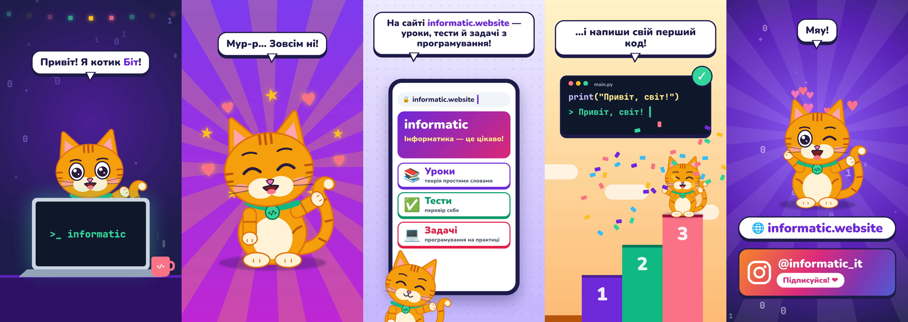

# Котик Біт × informatic.website — 2D-мультик 9:16

`informatic-cat-9x16.mp4` — 32 с, 1080×1920, 30 fps, H.264 + AAC.

Зроблено в [OpenMontage](https://github.com/calesthio/OpenMontage) (pipeline `character-animation`,
Remotion, атель'є-режим). Джерело — у `project/`:

- `Cat.tsx` — SVG-риг кота (хвіст, тулуб, лапи, голова, вуха, очі, зіниці, брови, рот).
- `Composition.tsx` — 5 сцен: ноутбук → вихор символів → сайт на телефоні → сходинки й перший код → CTA.
- `build_audio.py` — локальний синтез музики, «котячого» голосу, мяу, муркотіння й звуків;
  пише `artifacts/timeline.json`, за яким синхронізуються рот і бульбашки.
- `art-direction.md`, `artifacts/decision_log.json` — арт-дирекція і журнал рішень.

Рендер: скопіюйте `project/` у `OpenMontage/projects/informatic-cat/`, виконайте
`python3 build_audio.py`, потім `video_compose` з `artifacts/edit_decisions.json`.
